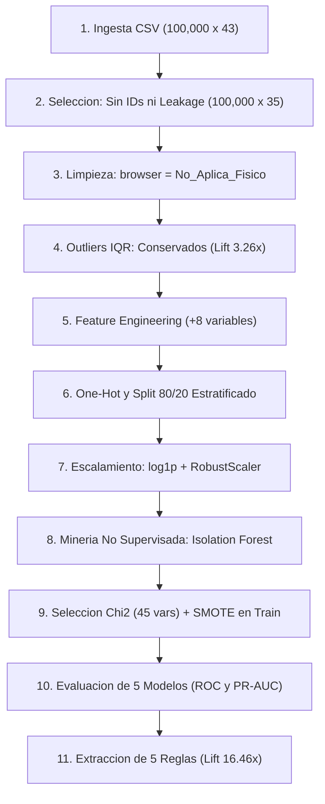

# Documentación Técnica: Proceso KDD para Detección Automatizada de Fraude, Descubrimiento de Anomalías y Reglas de Decisión — *Credit Card Fraud Detection 2026*

| Metadato | Detalle |
| :--- | :--- |
| **Dataset Fuente** | [credit_card_fraud_detection_2026.csv](file:///g:/Mi%20unidad/Drive.alumno.udg.mx/5to/DATA_MINING_Y_KNOWLEDGE_DISCOVERY/proyecto_final/Datasets/credit_card_fraud_detection_2026.csv) (`100,000` registros $\times$ `43` variables) |
| **Autor** | Roberto Alejandro Chagra Martínez (Código: `208447128`) |
| **Asignatura / Institución** | Data Mining y Knowledge Discovery — Centro Universitario de Guadalajara (UDG) |
| **Tecnologías** | Python `3.12`, `pandas`, `numpy`, `scikit-learn`, `imbalanced-learn` (`SMOTE`), `seaborn`, `matplotlib` |
| **Fecha** | **Pendiente** |

---

## 1. Resumen Ejecutivo y Propósito del Proyecto

Este proyecto integrador implementa de principio a fin las **7 etapas de la metodología KDD (*Knowledge Discovery in Databases*)** sobre el conjunto de datos transaccionales `credit_card_fraud_detection_2026.csv` (`100,000` transacciones calibradas con estadísticas de la Reserva Federal, Informe Nilson, FICO y el Banco Central Europeo).

El problema central resuelto consiste en **identificar señales débiles de fraude dentro de un conjunto de datos masivo y estadísticamente desbalanceado** (`97.945%` de operaciones legítimas frente a `2.055%` fraudulentas, razón `1 : 47.66`), articulando:
1. **Auditoría contra Fuga de Información (*Data Leakage*) y Sesgo de Selección:** Identificación de variables post-evento (`fraud_type`, `fraud_amount_lost`) y tratamiento estructural de los `41,709` valores faltantes en `browser` asociados a operaciones físicas (`POS Terminal` y `ATM`).
2. **Detección de Valores Atípicos (*Outlier Detection*):** Evaluación paramétrica/no paramétrica mediante **Criterio $1.5 \times \text{IQR}$ de Tukey** y minería no supervisada con **`IsolationForest`**, demostrando que los valores atípicos concentran hasta **`3.75x`** más probabilidad de fraude.
3. **Ingeniería y Selección Estadística de Características:** Creación de `8` variables derivadas de dominio (incluyendo el índice multiseñal `composite_risk_index`) y filtrado mediante **Prueba Chi-Cuadrado ($\chi^2$)** e importancia Gini.
4. **Clasificación Supervisada con Balanceo Sintético (*SMOTE*):** Comparación rigurosa de `5` algoritmos (*Dummy Baseline*, *Regresión Logística*, *Árbol de Decisión*, *Random Forest* y *Gradient Boosting*) con calibración de umbral sensible al costo ($F_2\text{-Score}$).
5. **Extracción de Reglas de Decisión Accionables:** Descubrimiento y validación de reglas de negocio interpretables con un *Lift* de hasta **`16.46x`** sobre la tasa base de fraude.

---

## 2. Arquitectura del Pipeline KDD

---

## 3. Desarrollo Detallado por Etapas KDD

### 3.1 Etapa 1 y Etapa 2: Comprensión del Dominio y Selección de Datos
* **Distribución de la clase objetivo (`is_fraud`):**
  * Clase `0` (*Legitimate*): **`97,945`** registros (`97.945%`).
  * Clase `1` (*Fraud*): **`2,055`** registros (`2.055%`).
  * Pérdida financiera acumulada: **\$279,842.20 USD** (media de \$136.18 USD y máximo de \$4,482.16 USD por evento fraudulento).
* **Desglose por tipología de fraude (`fraud_type`):**
  * `Card-Not-Present`: **`1,054`** casos (`51.29%`)
  * `Account-Takeover`: **`447`** casos (`21.75%`)
  * `Synthetic-Identity`: **`309`** casos (`15.04%`)
  * `Card-Present`: **`245`** casos (`11.92%`)
* **Auditoría de *Data Leakage*:** Se excluyeron `fraud_type` y `fraud_amount_lost` del conjunto predictor $X$ porque son variables registradas *post-facto* con dependencia determinista sobre `is_fraud`. También se descartaron los identificadores `transaction_id`, `customer_id`, `card_id`, `merchant_id`, `transaction_datetime` y `customer_state`.

### 3.2 Etapa 3: Limpieza de Datos y Diagnóstico de Valores Atípicos (*Outliers*)
1. **Tratamiento de valores faltantes estructurales en `browser` (`41,709` registros, `41.71%`):**
   * Se demostró que los `41,709` valores `NaN` se distribuyen exactamente en `35,777` transacciones `In-store` (`POS Terminal`) y `5,932` transacciones `ATM`.
   * Eliminar filas habría borrado el $100\%$ de la operatoria presencial del banco (**Sesgo de Selección**). Se imputó la categoría explícita `'No_Aplica_Fisico'`.
2. **Diagnóstico de Valores Atípicos ($1.5 \times \text{IQR}$):**

| Variable Analizada | $Q_1$ | Mediana ($Q_2$) | $Q_3$ | $\text{IQR}$ | Límite Sup. | Outliers Detectados | Fraude en Normal (`%`) | Fraude en Outliers (`%`) | Lift de Riesgo |
| :--- | :---: | :---: | :---: | :---: | :---: | :---: | :---: | :---: | :---: |
| `transactions_last_1h` | `0.00` | `0.00` | `1.00` | `1.00` | `2.50` | **8,990** (`8.99%`) | `1.71%` | **`5.57%`** | **`3.26x`** |
| `amount_last_1h` | `0.00` | `0.00` | `100.01` | `100.01` | `250.03` | **11,150** (`11.15%`) | `1.85%` | **`3.71%`** | **`2.01x`** |
| `amount_vs_avg_ratio` | `0.21` | `0.58` | `1.66` | `1.45` | `3.84` | **11,309** (`11.31%`) | `1.88%` | **`3.44%`** | **`1.83x`** |
| `distance_from_last_tx_km` | `5.20` | `13.30` | `31.90` | `26.70` | `71.95` | **15,617** (`15.62%`) | `1.85%` | **`3.18%`** | **`1.72x`** |
| `transaction_amount` | `21.28` | `52.26` | `129.72` | `108.44` | `292.38` | **9,959** (`9.96%`) | `1.95%` | **`3.02%`** | **`1.55x`** |

### 3.3 Etapa 4: Transformación e Ingeniería de Características
Se diseñaron **`8` variables derivadas** para capturar señales débiles de fraude:
* `velocity_tx_ratio_1h_24h` $= \frac{\text{transactions\_last\_1h}}{\text{transactions\_last\_24h} + 1}$
* `velocity_amt_ratio_1h_24h` $= \frac{\text{amount\_last\_1h}}{\text{amount\_last\_24h} + 1}$
* `credit_utilization_ratio` $= \frac{\text{transaction\_amount}}{\text{credit\_limit} + 1}$
* `zscore_amount_30d` $= \frac{\text{transaction\_amount} - \text{avg\_transaction\_amount\_30d}}{\text{std\_transaction\_amount\_30d} + 1}$
* `security_factors_count` $= \text{card\_present} + \text{used\_chip} + \text{used\_pin} \in \{0, 1, 2, 3\}$
* `is_night_tx` $= \mathbb{I}(\text{transaction\_hour} \le 4)$
* `is_new_account` $= \mathbb{I}(\text{account\_age\_days} \le 90)$
* `composite_risk_index`: Acumulador ponderado de 10 señales débiles concurrentes (eleva la tasa de fraude desde `0.04%` en nivel `0` hasta **`20.11%`** en nivel $\ge 5$).

Posteriormente se aplicó **Partición Estratificada 80/20** (`X_train`: `80,000` filas; `X_test`: `20,000` filas) seguida de **compresión logarítmica (`np.log1p`)** y **`RobustScaler`** ajustado exclusivamente sobre `X_train`.

### 3.4 Etapa 5 y Etapa 6: Minería de Datos y Evaluación Comparativa
* **Detección de Anomalías (`IsolationForest`):** En el conjunto de prueba (`20,000` transacciones), las `665` instancias etiquetadas como anómalas presentaron una tasa de fraude del **`7.07%`** frente al `1.88%` de las normales (**`3.75x` Lift**).
* **Selección Estadística ($\chi^2$) y Balanceo *SMOTE*:** Se seleccionaron las `45` características más informativas y se aplicó `SMOTE(sampling_strategy=0.30)` únicamente en `X_train` (`78,356` legítimas y `23,506` fraudulentas sintéticas).

| Modelo Evaluado (en `X_test`: `20,000` filas) | Umbral | Accuracy | Precision | Recall (Sensibilidad) | F1-Score | ROC-AUC | PR-AUC | Fraudes Detectados (`TP`) | Fraudes Omitidos (`FN`) |
| :--- | :---: | :---: | :---: | :---: | :---: | :---: | :---: | :---: | :---: |
| **1. Baseline Mayoritario (Dummy)** | `0.50` | `0.9795` | `0.0000` | `0.0000` | `0.0000` | `0.5000` | `0.0205` | `0` | `411` |
| **2. Regresión Logística (SMOTE)** | `0.35` | `0.8987` | `0.0903` | `0.4331` | `0.1495` | `0.8152` | `0.0964` | `178` | `233` |
| **3. Árbol de Decisión (SMOTE)** | `0.30` | `0.9367` | **`0.1349`** | `0.3844` | **`0.1997`** | `0.8103` | `0.1109` | `158` | `253` |
| **4. Random Forest (SMOTE)** | `0.50` | `0.8786` | `0.0895` | **`0.5353`** | `0.1534` | `0.8292` | `0.1039` | **`220`** | **`191`** |
| **5. Gradient Boosting (SMOTE)** | `0.15` | `0.9313` | `0.1288` | `0.4063` | `0.1956` | **`0.8379`** | **`0.1369`** | `167` | `244` |

### 3.5 Etapa 7: Interpretación del Conocimiento y Reglas de Decisión

| Código | Regla de Decisión Descubierta (Condición Lógica) | Transacciones Activadas | Fraudes Reales Capturados | Tasa de Fraude (`%`) | Lift vs. Promedio (`2.055%`) | Acción Recomendada |
| :---: | :--- | :---: | :---: | :---: | :---: | :--- |
| **R1** | `high_risk_country == 1` $\land$ `card_present == 0` $\land$ `transactions_last_1h >= 3` | `269` | `91` | **`33.83%`** | **`16.46x`** | Bloqueo preventivo inmediato |
| **R2** | `high_risk_country == 1` $\land$ `account_age_days <= 90` | `565` | `131` | **`23.19%`** | **`11.28x`** | Bloqueo + Verificación KYC |
| **R3** | `transaction_hour <= 4` $\land$ `international_transaction == 1` $\land$ `card_present == 0` | `902` | `114` | **`12.64%`** | **`6.15x`** | Reto 3D-Secure / Token Push |
| **R4** | `amount_vs_avg_ratio > 4.8` $\land$ `num_chargebacks_ever >= 2` $\land$ `card_present == 0` | `611` | `62` | **`10.15%`** | **`4.94x`** | Autenticación de dos factores |
| **R5** | `composite_risk_index >= 5` (Acumulación de señales débiles) | `2,859` | `575` | **`20.11%`** | **`9.79x`** | Escalamiento a motor ML + 2FA |

---

## 4. Artefactos Generados en `proyecto_final/Resultados/`
* [`01_desbalance_y_tipologias.png`](file:///g:/Mi%20unidad/Drive.alumno.udg.mx/5to/DATA_MINING_Y_KNOWLEDGE_DISCOVERY/proyecto_final/Resultados/01_desbalance_y_tipologias.png): Desbalance estadístico y distribución por modalidad de fraude.
* [`02_outliers_iqr_y_isolation_forest.png`](file:///g:/Mi%20unidad/Drive.alumno.udg.mx/5to/DATA_MINING_Y_KNOWLEDGE_DISCOVERY/proyecto_final/Resultados/02_outliers_iqr_y_isolation_forest.png): Curvas de densidad del puntaje `IsolationForest` y tasa de fraude por nivel de `composite_risk_index`.
* [`03_seleccion_variables_importancia.png`](file:///g:/Mi%20unidad/Drive.alumno.udg.mx/5to/DATA_MINING_Y_KNOWLEDGE_DISCOVERY/proyecto_final/Resultados/03_seleccion_variables_importancia.png): Ranking de importancia de variables (*Random Forest*) y estadístico Chi-Cuadrado ($\chi^2$).
* [`04_comparativa_modelos_curvas_roc_pr.png`](file:///g:/Mi%20unidad/Drive.alumno.udg.mx/5to/DATA_MINING_Y_KNOWLEDGE_DISCOVERY/proyecto_final/Resultados/04_comparativa_modelos_curvas_roc_pr.png): Curvas ROC y Precision-Recall comparativas en el conjunto de prueba.
* [`05_matrices_confusion.png`](file:///g:/Mi%20unidad/Drive.alumno.udg.mx/5to/DATA_MINING_Y_KNOWLEDGE_DISCOVERY/proyecto_final/Resultados/05_matrices_confusion.png): Matrices de confusión de los modelos supervisados con *SMOTE*.
* [`06_arbol_reglas_decision.png`](file:///g:/Mi%20unidad/Drive.alumno.udg.mx/5to/DATA_MINING_Y_KNOWLEDGE_DISCOVERY/proyecto_final/Resultados/06_arbol_reglas_decision.png): Árbol de decisión en unidades originales para extracción de reglas de negocio.
* [`resumen_modelos_kdd.csv`](file:///g:/Mi%20unidad/Drive.alumno.udg.mx/5to/DATA_MINING_Y_KNOWLEDGE_DISCOVERY/proyecto_final/Resultados/resumen_modelos_kdd.csv), [`reglas_negocio_validadas.csv`](file:///g:/Mi%20unidad/Drive.alumno.udg.mx/5to/DATA_MINING_Y_KNOWLEDGE_DISCOVERY/proyecto_final/Resultados/reglas_negocio_validadas.csv) y [`reglas_decision_fraude.txt`](file:///g:/Mi%20unidad/Drive.alumno.udg.mx/5to/DATA_MINING_Y_KNOWLEDGE_DISCOVERY/proyecto_final/Resultados/reglas_decision_fraude.txt).
