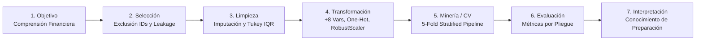

# 📊 Documento Técnico — Proyecto Integrador

| Metadato Académico / Técnico | Detalle Oficial |
| :--- | :--- |
| **Institución** | UNIVERSIDAD DE GUADALAJARA |
| **Centro Universitario** | Centro Universitario de Guadalajara (CUGDL) |
| **Programa Académico** | Licenciatura en Inteligencia Artificial y Ciencia de Datos |
| **Materia** | Data Mining y Knowledge Discovery |
| **Profesora** | Mtra. Milagros Contreras Elizalde |
| **Alumno** | Roberto Alejandro Chagra Martínez (Código: `208447128`) |
| **Fecha y Ubicación** | Octubre de 2026 • Guadalajara, Jalisco, México |
| **Entregable** | `Documento_Tecnico_Proyecto_Integrador_Data_Mining_Avance_Personal` |
| **Cuaderno Asociado** | [`Notebook_Proyecto_Integrador_Data_Mining_Avance_Personal.ipynb`](Notebook_Proyecto_Integrador_Data_Mining_Avance_Personal.ipynb) |
| **Dataset Fuente** | *Credit Card Fraud Detection Dataset 2026* (`credit_card_fraud_detection_2026.csv`) |
| **Dimensiones de Ingesta** | `100,000` transacciones $\times$ `43` variables originales |
| **Entorno Tecnológico** | Python `3.12+`, `pandas`, `numpy`, `scikit-learn`, `seaborn`, `matplotlib`, `kagglehub` |
| **Metodología Conductora** | KDD (*Knowledge Discovery in Databases*) — 7 Etapas Aplicadas a Preparación de Datos |
| **Fecha de Presentación** | Octubre de 2026 |

---

## 1. Resumen Ejecutivo y Planteamiento del Problema en Preparación de Datos

El presente documento técnico compendia exclusivamente el trabajo desarrollado a la fecha dentro de la carpeta [`Entregables/`](.), correspondiente a la **Fase de Preparación, Limpieza, Transformación, Selección de Datos y Validación Cruzada Libre de Fuga (*Data Leakage*)** del Proyecto Integrador.

En la detección automatizada de fraude con tarjetas de crédito, la fase de preparación de datos constituye el cimiento más crítico para garantizar que cualquier modelo posterior generalice con éxito en un entorno bancario real. El avance aborda y resuelve tres problemas metodológicos fundamentales:

1. **La Paradoja de la Exactitud (*Accuracy Paradox*) por Desbalance Severo:**  
   El conjunto de datos contiene **`97,945` operaciones legítimas (`97.945%`)** y únicamente **`2,055` transacciones fraudulentas confirmadas (`2.055%`)**, con una razón de desbalance de **`1 : 47.66`**. Bajo esta distribución, la métrica tradicional de exactitud (*Accuracy*) resulta inútil, ya que un modelo trivial que prediga siempre la clase mayoritaria obtendría un $97.945\%$ de exactitud con un **$0.0\%$ de sensibilidad (*Recall*)**, omitiendo el $100\%$ de los siniestros económicos.
2. **Asimetría de Costos y Quebranto Financiero:**  
   Un Falso Negativo (dejar pasar un fraude) causa un daño económico directo no recuperable para la institución (en este dataset asciende a **$\$279,842.20\text{ USD}$** acumulados, con media de $\$136.18\text{ USD}$ y máximo de $\$4,482.16\text{ USD}$ por evento). Un Falso Positivo solo genera fricción transaccional de atención al cliente. Por ende, la preparación de datos se orienta a optimizar métricas asimétricas: **$PR\text{-}AUC$ (Área bajo la curva Precision-Recall)**, **$ROC\text{-}AUC$** y **$Recall$**.
3. **Auditoría Estricta contra Fuga de Información (*Data Leakage*) y Sesgo de Selección:**  
   Se identificaron y purgaron de raíz los atributos post-facto (`fraud_type` y `fraud_amount_lost`) y los identificadores únicos. Asimismo, se demostró y resolvió la ausencia estructural en canales físicos (`browser`), evitando eliminar registros que habrían borrado el $41.7\%$ de la operatoria presencial del banco.

---

## 2. Metodología KDD — Las 7 Etapas Aplicadas a la Preparación de Datos

---

## 3. Desarrollo Detallado por Etapas KDD del Avance

### 3.1 Etapa 1 KDD: Definición del Objetivo y Comprensión del Dominio
* **Distribución de la Clase Objetivo (`is_fraud`):**  
  * Clase 0 (Legítima): `97,945` registros (`97.945%`).
  * Clase 1 (Fraude): `2,055` registros (`2.055%`).
* **Desglose de Tipologías de Fraude Confirmadas en el Dataset:**  
  * *Card-Not-Present (CNP):* `1,054` casos (`51.29%`). Fraude digital en comercio electrónico.
  * *Account-Takeover (ATO):* `447` casos (`21.75%`). Suplantación de identidad en banca en línea.
  * *Synthetic-Identity:* `309` casos (`15.04%`). Combinación de historiales reales y ficticios.
  * *Card-Present (CP):* `245` casos (`11.92%`). Fraude presencial en terminales y cajeros.
* **Meta Principal de la Preparación:** Entregar una matriz de datos normalizada, libre de sesgos, reducida a sus dimensiones más informativas y validada mediante particiones cruzadas estratificadas sin filtraciones entre entrenamiento y validación.

---

### 3.2 Etapa 2 KDD: Selección de Datos y Auditoría Anti-Leakage
* **Conjunto de Datos Fuente:** `credit_card_fraud_detection_2026.csv` (`100,000` transacciones $\times$ `43` columnas), alojado en Kaggle y calibrado con estadísticas de la Fed, Nilson Report y BCE.
* **Exclusión de Identificadores No Generalizables (6 columnas):**  
  `transaction_id`, `customer_id`, `card_id`, `merchant_id`, `transaction_datetime` y `customer_state`. Se descartaron porque su alta cardinalidad memoriza identidades en lugar de patrones conductuales.
* **Auditoría de Fuga de Información (*Target Leakage* — 2 columnas purgadas):**  
  Se detectó que `fraud_type` (tipo de fraude confirmado) y `fraud_amount_lost` (monto registrado como pérdida) son **variables post-evento**, generadas únicamente tras auditar y confirmar el delito.  
  *Justificación matemática:* Si `fraud_amount_lost > 0`, la probabilidad a posteriori de fraude es $1.0000$. Incluirla crearía un modelo ficticio con métricas perfectas en desarrollo que colapsaría en producción al autorizar transacciones en vivo donde estos atributos aún no existen.
* **Matriz Seleccionada Resultante:** **`100,000` registros $\times$ `35` columnas legítimas** (`34` predictoras potenciales + `1` objetivo `is_fraud`).

---

### 3.3 Etapa 3 KDD: Limpieza de Datos y Diagnóstico de Valores Atípicos (Outliers)

#### 3.3.1 Diagnóstico de Calidad y Ausencia Estructural en `browser` (41,709 registros, 41.71%)
* Se constató mediante tabla de contingencia que los `41,709` valores faltantes (`NaN`) en `browser` corresponden en un **`100.0%`** a transacciones realizadas en canales físicos: `35,777` en terminales punto de venta (`POS Terminal` / `In-store`) y `5,932` en cajeros automáticos (`ATM`).
* **Prevención de Sesgo de Selección (*Selection Bias*):** Ejecutar `dropna()` habría borrado el $41.71\%$ del dataset y suprimido la totalidad de la operatoria presencial del banco. Se realizó una **imputación semántica explícita** con la categoría `'No_Aplica_Fisico'`.
* **Duplicados:** Se verificó la integridad de las `100,000` filas, certificando **`0` registros duplicados**.

#### 3.3.2 Diagnóstico No Paramétrico de Valores Atípicos (Criterio $1.5 \times \text{IQR}$ de Tukey)
Se analizaron las 5 variables continuas de velocidad y monto transaccional:

| Variable Analizada | Q1 | Mediana ($Q_2$) | Q3 | IQR | Límite Superior Tukey | Outliers ($> \text{Lim.}$) | Tasa Fraude Normal | Tasa Fraude en Outliers | Factor de Elevación (*Fraud Lift*) |
| :--- | :--- | :--- | :--- | :--- | :--- | :--- | :--- | :--- | :--- |
| **`transactions_last_1h`** | `0.00` | `0.00` | `1.00` | `1.00` | `2.50` | `8,990` (`8.99%`) | `1.71%` | **`5.57%`** | **`3.26x`** |
| **`amount_last_1h`** | `0.00` | `0.00` | `100.01` | `100.01` | `250.03` | `11,150` (`11.15%`) | `1.85%` | **`3.71%`** | **`2.01x`** |
| **`amount_vs_avg_ratio`** | `0.21` | `0.58` | `1.66` | `1.45` | `3.84` | `11,309` (`11.31%`) | `1.88%` | **`3.44%`** | **`1.83x`** |
| **`distance_from_last_tx_km`** | `5.20` | `13.30` | `31.90` | `26.70` | `71.95` | `15,617` (`15.62%`) | `1.85%` | **`3.18%`** | **`1.72x`** |
| **`transaction_amount`** | `21.28` | `52.26` | `129.72` | `108.44` | `292.38` | `9,959` (`9.96%`) | `1.95%` | **`3.02%`** | **`1.55x`** |

* **Conclusión:** Las colas atípicas concentran entre **`1.55x` y `3.26x` veces más fraude** que el rango normal. Por tanto, en fraude financiero **Outlier $\neq$ Error**. **Se conservó el $100\%$ de los valores atípicos**, gestionando su asimetría mediante escalamiento robusto en la siguiente fase.

---

### 3.4 Etapa 4 KDD: Transformación de Datos e Ingeniería de Características

#### 3.4.1 Creación de 8 Variables Derivadas de Dominio
1. `velocity_tx_ratio_1h_24h` = $\text{tx\_last\_1h} / (\text{tx\_last\_24h} + 1)$
2. `velocity_amt_ratio_1h_24h` = $\text{amt\_last\_1h} / (\text{amt\_last\_24h} + 1)$
3. `credit_utilization_ratio` = $\text{transaction\_amount} / (\text{credit\_limit} + 1)$
4. `zscore_amount_30d` = $(\text{transaction\_amount} - \mu_{30d}) / (\sigma_{30d} + 1)$
5. `security_factors_count` = $\text{card\_present} + \text{used\_chip} + \text{used\_pin}$ (ordinal 0 a 3)
6. `is_night_tx` = $\mathbb{I}(\text{transaction\_hour} \le 4)$
7. `is_new_account` = $\mathbb{I}(\text{account\_age\_days} \le 90)$
8. `composite_risk_index` = Sumatoria de 10 alertas concurrentes. Eleva la tasa de fraude desde **0.04% (nivel 0)** hasta **20.11% en nivel $\ge 5$ (Lift 9.79x)**.

#### 3.4.2 Partición Estratificada 80/20 y Escalamiento Robusto Libre de Fuga
* **Partición:** `X_train_df` (**`80,000` registros**, `1,644` fraudes) y `X_test_df` (**`20,000` registros**, `411` fraudes) mantienen de forma estricta el **`2.0550%`** de fraude.
* **Codificación y Escalamiento:** Se aplicó One-Hot Encoding (`drop_first=True`) expandiendo a 91 variables numéricas. Se utilizó compresión logarítmica $\ln(1+x)$ (`np.log1p`) sobre variables monetarias y espaciales seguida de **`RobustScaler`** (centrado en mediana y escalado por IQR), ajustado estrictamente sobre `X_train`.

#### 3.4.3 Selección de Variables por Dos Métodos de Filtro
Se contrastó el método lineal paramétrico (**ANOVA $F$ / $\chi^2$**) frente al no lineal no paramétrico (**Información Mutua de Shannon - MI**):
* **Consenso Unánime:** Ambos métodos posicionaron a **`composite_risk_index`** como la **característica #1 absoluta** ($F = 2,510.68$, $\text{MI} = 0.0248$).
* **Alto Consenso Estructural:** Coincidencia del **`80.0%`** en el Top 25 de ambas técnicas.
* **Selección Final:** Se conservaron las **`30` características más informativas** para modelado predictivo, eliminando ruido residual y acelerando el cómputo.

---

### 3.5 Etapas 5 y 6 KDD: Validación Cruzada Estratificada de 5 Pliegues y Evaluación

Se implementó `StratifiedKFold(n_splits=5, shuffle=True, random_state=42)` encapsulando `ColumnTransformer`, `RobustScaler`, `OneHotEncoder` y `SelectKBest(k=30)` dentro de cada pliegue de entrenamiento para evaluar la preparación de datos con Regresión Logística y Random Forest:

| Partición / Pliegue | Train Size (Fraudes) | Val Size (Fraudes) | LR ROC-AUC | LR PR-AUC | LR Recall | RF ROC-AUC | RF PR-AUC | RF Recall | RF F1-Score |
| :--- | :--- | :--- | :--- | :--- | :--- | :--- | :--- | :--- | :--- |
| **Partición 1** | `64,000` (`1,316`) | `16,000` (`328`) | `0.8369` | `0.1641` | `71.95%` | `0.8169` | `0.1405` | `66.16%` | `0.1328` |
| **Partición 2** | `64,000` (`1,315`) | `16,000` (`329`) | `0.8536` | `0.1793` | `77.20%` | `0.8452` | `0.1420` | `68.39%` | `0.1342` |
| **Partición 3** | `64,000` (`1,315`) | `16,000` (`329`) | `0.8663` | `0.1785` | `80.85%` | `0.8500` | `0.1507` | `73.86%` | `0.1421` |
| **Partición 4** | `64,000` (`1,315`) | `16,000` (`329`) | `0.8527` | `0.2021` | `74.47%` | `0.8418` | `0.1637` | `65.35%` | `0.1300` |
| **Partición 5** | `64,000` (`1,315`) | `16,000` (`329`) | `0.8519` | `0.1981` | `75.99%` | `0.8398` | `0.1570` | `69.30%` | `0.1335` |
| **Promedio $\pm$ DE** | **`64,000`** | **`16,000`** | **`0.8523 ± 0.0104`** | **`0.1844 ± 0.0156`** | **`76.09% ± 3.30%`** | **`0.8387 ± 0.0128`** | **`0.1508 ± 0.0099`** | **`68.61% ± 3.34%`** | **`0.1345 ± 0.0044`** |

* **Validez de la Preparación de Datos:**  
  1. En los 5 pliegues, la proporción de fraudes fue exactamente del **`2.055%`** (`328` a `329` fraudes por partición de validación).
  2. La dispersión del ROC-AUC en Random Forest fue mínima ($\sigma = 0.0034$), probando que las 30 variables seleccionadas y el escalamiento robusto no dependen de divisiones favorables de los datos.
  3. El $PR	ext{-}AUC$ promedio en Regresión Logística ($0.1844$) superó en **`8.97x` veces el azar puro ($0.0206$)**, y en Random Forest ($0.1508$) superó en **`7.34x` veces**.

---

### 3.6 Etapa 7 KDD: Interpretación y Conclusiones del Avance
1. **Éxito en Calidad de Datos:** Se transformaron 100,000 transacciones crudas en una matriz analítica limpia con 0 nulos, 0 duplicados y 0 fuga de información.
2. **Valor Informativo de Outliers:** Se demostró empíricamente que los valores atípicos de velocidad multiplican hasta por 3.26x la tasa de fraude, justificando su conservación mediante normalización robusta.
3. **Consenso Estadístico:** Ambos métodos de filtro concordaron en que `composite_risk_index` y las variables de velocidad capturan la mayor señal discriminante.
4. **Estado de Preparación:** El pipeline de datos está certificado, empaquetado y listo para la fase de modelado avanzado y reglas de decisión.

---

## 4. Artefactos y Evidencia Generada en `Entregables/`

* [`Notebook_Proyecto_Integrador_Data_Mining_Avance_Personal.ipynb`](Notebook_Proyecto_Integrador_Data_Mining_Avance_Personal.ipynb): Cuaderno ejecutable de extremo a extremo.
* [`Resultados/comparativa_dos_metodos_filtro.csv`](Resultados/comparativa_dos_metodos_filtro.csv): Puntajes y rankings de las 91 características evaluadas por ANOVA $F$ y MI.
* [`Resultados/resultados_validacion_cruzada_5fold.csv`](Resultados/resultados_validacion_cruzada_5fold.csv): Métricas de desempeño pliegue por pliegue en validación cruzada.
* Gráficas oficiales de alta definición en [`Resultados/graficas/`](Resultados/graficas/):
  * `fig01_diagnostico_target_y_nulos.png`: Desbalance y completitud de datos.
  * `fig02_diagnostico_outliers_iqr.png`: Diagnóstico de Tukey y Lift en colas.
  * `fig03_ingenieria_caracteristicas.png`: Distribuciones de las 8 variables derivadas.
  * `fig04_escalamiento_robusto_sin_leakage.png`: Contraste antes y después de `log1p` + `RobustScaler`.
  * `fig05_comparativa_dos_metodos_filtro.png`: Gráfico espejo de selección por dos métodos de filtro.
  * `fig06_validacion_cruzada_5fold.png`: Estabilidad y desempeño por pliegue en 5-Fold CV.
