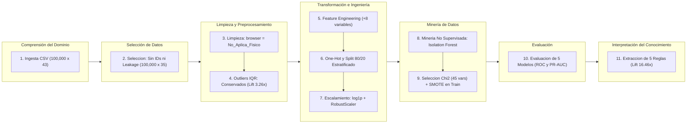

# Documentación Técnica: Proceso KDD para Detección Automatizada de Fraude, Descubrimiento de Anomalías y Reglas de Decisión — *Credit Card Fraud Detection 2026*

| Metadato | Detalle |
| :--- | :--- |
| **Dataset Fuente** | [`credit_card_fraud_detection_2026.csv`](../Datasets/credit_card_fraud_detection_2026.csv) (`100,000` registros $\times$ `43` variables) |
| **Tecnologías** | Python `3.12`, `pandas`, `numpy`, `scikit-learn`, `imbalanced-learn` (`SMOTE`), `seaborn`, `matplotlib` |

---

## 1. Resumen Ejecutivo y Propósito del Proyecto

Este proyecto implementa de principio a fin las **7 etapas de la metodología KDD (*Knowledge Discovery in Databases*)** sobre el conjunto de datos transaccionales `credit_card_fraud_detection_2026.csv` (`100,000` transacciones calibradas con estadísticas de la Reserva Federal, Informe Nilson, FICO y el Banco Central Europeo).

El problema central resuelto consiste en **identificar señales débiles de fraude dentro de un conjunto de datos masivo y estadísticamente desbalanceado** (`97.945%` de operaciones legítimas frente a `2.055%` fraudulentas, razón `1 : 47.66`), articulando:
1. **Auditoría contra Fuga de Información (*Data Leakage*) y Sesgo de Selección:** Identificación de variables post-evento (`fraud_type`, `fraud_amount_lost`) y tratamiento estructural de los `41,709` valores faltantes en `browser` asociados a operaciones físicas (`POS Terminal` y `ATM`).
2. **Detección de Valores Atípicos (*Outlier Detection*):** Evaluación paramétrica/no paramétrica mediante **Criterio $1.5 \times \text{IQR}$ de Tukey** y minería no supervisada con **`IsolationForest`**, demostrando que los valores atípicos concentran hasta **`3.75x`** más probabilidad de fraude.
3. **Ingeniería y Selección Estadística de Características:** Creación de `8` variables derivadas de dominio (incluyendo el índice multiseñal `composite_risk_index`) y filtrado mediante **Prueba Chi-Cuadrado ($\chi^2$)** e importancia Gini.
4. **Clasificación Supervisada con Balanceo Sintético (*SMOTE*):** Comparación rigurosa de `5` algoritmos (*Dummy Baseline*, *Regresión Logística*, *Árbol de Decisión*, *Random Forest* y *Gradient Boosting*) con calibración de umbral sensible al costo ($F_2\text{-Score}$).
5. **Extracción de Reglas de Decisión Accionables:** Descubrimiento y validación de reglas de negocio interpretables con un *Lift* de hasta **`16.46x`** sobre la tasa base de fraude.

---

## 2. Arquitectura del Pipeline KDD y Modalidades de Ejecución

### 2.1 Arquitectura del Pipeline

---

### 2.2 Modalidades de Ejecución
### Catálogo de Módulos y Entregas

**1. Modalidad 1 — Entrega Unificada (../src/Entrega_Unificada/):**
- Proyecto_Final_KDD_Deteccion_Fraude_2026.ipynb: Cuaderno Jupyter maestro de principio a fin.
- Proyecto_final_data_mining.py: Script completo ejecutable en un solo paso.

**2. Modalidad 2 — Entrega Modular en Notebooks Separados (../src/Entrega_Modular_en_Notebooks_Separados/):**
- 01_KDD_Seleccion_Limpieza_y_Outliers.ipynb
- 02_KDD_Transformacion_Ingenieria_y_Seleccion_Variables.ipynb
- 03_KDD_Mineria_IsolationForest_SMOTE_y_Modelado.ipynb
- 04_KDD_Evaluacion_Interpretacion_y_Reglas_Decision.ipynb

**3. Modalidad 3 — Paquete Modular de Ingeniería de Software (../src/Entrega_Modular_de_Ingenieria_de_Software_en_Python/):**
- orquestador_modular_kdd.py
- fase1_seleccion_y_limpieza.py
- fase2_transformacion_y_seleccion.py
- fase3_mineria_anomalias_y_clasificacion.py
- fase4_evaluacion_y_reglas_decision.py

**4. Documentación Complementaria (../Documentacion_adicional/):**
- Diccionario_Funciones_Proyecto_Final_KDD.md
- Selección de base de datos.pdf

---

## 3. Desarrollo Detallado por Etapas KDD

### 3.1 Etapa 1 y Etapa 2: Comprensión del Dominio y Selección de Datos
- Distribución de la clase objetivo (is_fraud):
  * Clase 0 (Legitimate): 97,945 registros (97.945%).
  * Clase 1 (Fraud): 2,055 registros (2.055%).
  * Pérdida financiera acumulada: $279,842.20 USD (media de $136.18 USD y máximo de $4,482.16 USD por evento fraudulento).
- Desglose por tipología de fraude (fraud_type):
  * Card-Not-Present: 1,054 casos (51.29%)
  * Account-Takeover: 447 casos (21.75%)
  * Synthetic-Identity: 309 casos (15.04%)
  * Card-Present: 245 casos (11.92%)
- Auditoría de Data Leakage: Se excluyeron fraud_type y fraud_amount_lost del conjunto predictor X porque son variables registradas post-facto con dependencia determinista sobre is_fraud. También se descartaron los identificadores transaction_id, customer_id, card_id, merchant_id, transaction_datetime y customer_state.

---

### 3.2 Etapa 3: Limpieza de Datos y Diagnóstico de Valores Atípicos (Outliers)
1. Tratamiento de valores faltantes estructurales en browser (41,709 registros, 41.71%):
   * Se demostró que los 41,709 valores NaN se distribuyen exactamente en 35,777 transacciones In-store (POS Terminal) y 5,932 transacciones ATM.
   * Eliminar filas habría borrado el 100% de la operatoria presencial del banco (Sesgo de Selección). Se imputó la categoría explícita 'No_Aplica_Fisico'.
2. Diagnóstico de Valores Atípicos (1.5 x IQR):  
   | Variable Analizada | Q1 | Mediana | Q3 | IQR | Lim. Sup. | Outliers | Fraude Normal | Fraude Outliers | Lift |  
   | ------ | ------ | ------ | ------| ------ | ------ | ------ | ------ | ------| ------ |  
   | **transactions_last_1h** | 0.00 | 0.00 | 1.00 | 1.00 | 2.50 | 8,990 (8.99%) | 1.71% | 5.57% | 3.26x |  
   | **amount_last_1h** | 0.00 | 0.00 | 100.01 | 100.01 | 250.03 | 11,150 (11.15%) | 1.85% | 3.71% | 2.01x |  
   | **amount_vs_avg_ratio** | 0.21 | 0.58 | 1.66 | 1.45 | 3.84 | 11,309 (11.31%) | 1.88% | 3.44% | 1.83x |  
   | **distance_from_last_tx_km** | 5.20 | 13.30 | 31.90 | 26.70 | 71.95 | 15,617 (15.62%) | 1.85% | 3.18% | 1.72x |  
   | **transaction_amount** | 21.28 | 52.26 | 129.72 | 108.44 | 292.38 | 9,959 (9.96%) | 1.95% | 3.02% | 1.55x |

---

### 3.3 Etapa 4: Transformación e Ingeniería de Características
Se diseñaron 8 variables derivadas para capturar señales débiles de fraude:  

| Variable Creada | Tipo de Variable | Fórmula |  
| :--- | :--- | :--- |  
| **velocity_tx_ratio_1h_24h** | Numérica | Transacciones (1h) / (Transacciones (24h) + 1) |  
| **velocity_amt_ratio_1h_24h** | Numérica | Monto (1h) / (Monto (24h) + 1) |  
| **credit_utilization_ratio** | Numérica | Monto Transacción / (Límite de Crédito + 1) |  
| **zscore_amount_30d** | Numérica | (Monto Actual - Media 30d) / (Desviación 30d + 1) |  
| **security_factors_count** | Numérica | Tarjeta Presente + Chip + PIN |  
| **is_night_tx** | Booleana | 1 si Hora es <= 4 |  
| **is_new_account** | Booleana | 1 si Antigüedad Días es <= 90 |  
| **composite_risk_index** | Numérica | Acumulador ponderado de 10 señales débiles concurrentes (eleva la tasa de fraude desde 0.04% en nivel 0 hasta 20.11% en nivel >= 5) |  

Posteriormente se aplicó Partición Estratificada 80/20 seguida de compresión logarítmica y RobustScaler ajustado exclusivamente sobre X_train.

---

### 3.4 Etapa 5 y Etapa 6: Minería de Datos y Evaluación Comparativa
- Detección de Anomalías (IsolationForest): En el conjunto de prueba, las 665 instancias etiquetadas como anómalas presentaron una tasa de fraude del 7.07% frente al 1.88% de las normales (3.75x Lift).
- Selección Estadística y Balanceo SMOTE: Se seleccionaron las 45 características más informativas y se aplicó SMOTE únicamente en X_train.

**Resultados de Modelos Evaluados:**
| Modelo | Umbral | Accuracy | Precision | Recall | F1-Score | ROC-AUC | PR-AUC | Fraude Dtectados | Omitidos |  
| ------ | ------ | ------ | ------| ------ | ------ | ------ | ------ | ------| ------ |
| **Baseline Mayoritario (Dummy)** | 0.50 | 0.9795 | 0.0000 | 0.0000 | 0.0000 | 0.5000 | 0.0205 | 0 | 411
| **Regresión Logística (SMOTE)** | 0.35 | 0.8987 | 0.0903 | 0.4331 | 0.1495 | 0.8152 | 0.0964 | 178 | 233
| **Árbol de Decisión (SMOTE)** | 0.30 | 0.9367 | 0.1349 | 0.3844 | 0.1997 | 0.8103 | 0.1109 | 158 | 253
| **Random Forest (SMOTE)** | 0.50 | 0.8786 | 0.0895 | 0.5353 | 0.1534 | 0.8292 | 0.1039 | 220 | 191
| **Gradient Boosting (SMOTE)** | 0.15 | 0.9313 | 0.1288 | 0.4063 | 0.1956 | 0.8379 | 0.1369 | 167 | 244

---

### 3.5 Etapa 7: Interpretación del Conocimiento y Reglas de Decisión  
| ID Regla | Condicion Logica | Fraudes Detectados | Precisión (Tasa de Fraude) | Lift sobre Base (`2.055%`) | Acción Bancaria Recomendada |  
| ----- | ----- | ----- | ----- | ----- | ----- |  
| **Regla 1** | `high_risk_country == 1` y `card_present == 0` y `transactions_last_1h >= 3` | 91 | 33.83% | 16.46x | Bloqueo preventivo |  
| **Regla 2** | `high_risk_country == 1` y `account_age_days <= 90` | 131 | 23.19% | 11.28x | Bloqueo + KYC |  
| **Regla 3** | `transaction_hour <= 4` y `international_transaction == 1` y `card_present == 0` | 114 | 12.64% | 6.15x | Reto 3D-Secure |  
| **Regla 4** | `amount_vs_avg_ratio > 4.8` y `num_chargebacks_ever >= 2` y `card_present == 0` | 62 | 10.15% | 4.94x | Autenticación 2FA |  
| **Regla 5** | `composite_risk_index >= 5` | 575 | 20.11% | 9.79x | Escalamiento a motor ML + 2FA |  

---

## 4. Artefactos Generados en results/
- 01_desbalance_y_tipologias.png: Desbalance estadístico y distribución por modalidad de fraude.
- 02_outliers_iqr_y_isolation_forest.png: Curvas de densidad del puntaje IsolationForest y tasa de fraude por nivel de composite_risk_index.
- 03_seleccion_variables_importancia.png: Ranking de importancia de variables (Random Forest) y estadístico Chi-Cuadrado.
- 04_comparativa_modelos_curvas_roc_pr.png: Curvas ROC y Precision-Recall comparativas en el conjunto de prueba.
- 05_matrices_confusion.png: Matrices de confusión de los modelos supervisados con SMOTE.
- 06_arbol_reglas_decision.png: Árbol de decisión en unidades originales para extracción de reglas de negocio.
- resumen_modelos_kdd.csv, reglas_negocio_validadas.csv y reglas_decision_fraude.txt.