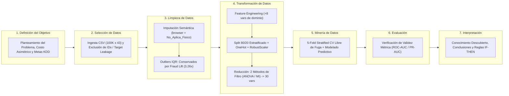
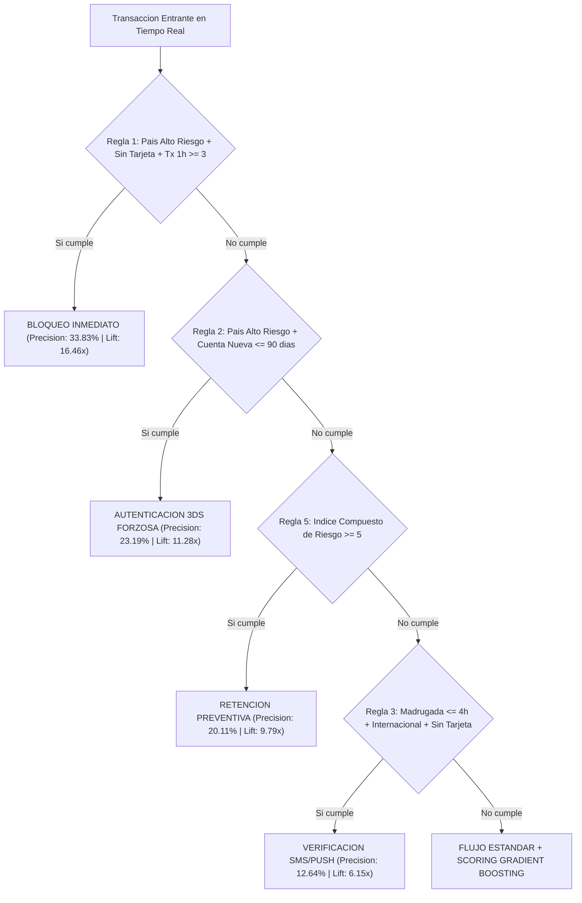

#  💳 Detección Automatizada de Fraude, Descubrimiento de Anomalías y Reglas de Decisión (KDD 2026)


[](LICENSE)

[](https://www.python.org/)

[](https://jupyter.org/)

[](https://scikit-learn.org/)

[](https://imbalanced-learn.org/)

[](https://pandas.pydata.org/)

[](https://numpy.org/)

[-8A2BE2?style=for-the-badge)]()

[](Datasets/credit_card_fraud_detection_2026.csv)

[]()


> **Proyecto Final Integrador — Minería de Datos y Descubrimiento de Conocimiento (KDD)**  
> **Institución:** Centro Universitario de Guadalajara (CUGDL) — Universidad de Guadalajara  
> **Programa:** Licenciatura en Inteligencia Artificial y Ciencia de Datos  
> **Profesora Titular:** Mtra. Milagros Contreras Elizalde  
> **Alumno Investigador:** Roberto Alejandro Chagra Martínez (Código: `208447128`)  
> **Fuente de Datos:** [Kaggle — Credit Card Fraud Detection Dataset 2026](https://www.kaggle.com/datasets/mohankrishnathalla/credit-card-fraud-detection-dataset-2026/data) (Mohan Krishna Thalla)  
> **Modalidad de Entrega Oficial:** Cuaderno Interactivo Ejecutable (`.ipynb`) + Reporte Técnico Oficial en PDF (Arial 11, interlineado 1.5)  


---


## 1. Descripción General del Proyecto


Este repositorio implementa de principio a fin el proceso de **Knowledge Discovery in Databases (KDD)** sobre el conjunto de datos transaccionales `credit_card_fraud_detection_2026.csv` (**100,000 transacciones** y **43 atributos**) con el objetivo de:


1. **Superar el desbalance severo de clases** ($97.945\%$ transacciones legítimas vs. $2.055\%$ fraudulentas, razón $1:47.66$) donde la exactitud global (*Accuracy*) enmascara por completo a la clase minoritaria.

2. **Prevenir la Fuga de Información (*Data Leakage*) y el Sesgo de Selección (*Selection Bias*)** mediante auditoría de causalidad temporal, tratamiento semántico de valores faltantes estructurales y partición estratificada previa a cualquier escalamiento o balanceo sintético (*SMOTE*).

3. **Combinar Minería No Supervisada y Supervisada (Enfoque Híbrido):** Detectar comportamientos atípicos multivariados mediante *Isolation Forest* e inyectar sus puntajes de anomalía dentro de modelos de clasificación supervisada (*Regresión Logística*, *Árboles de Decisión*, *Random Forest* y *Gradient Boosting*).

4. **Extraer Conocimiento Accionable (*White-Box Rules*):** Traducir los patrones descubiertos en **5 Reglas de Decisión Si-Entonces (*IF-THEN*)** de alta precisión y explicabilidad para motores bancarios antifraude en tiempo real.


---


## 2. Arquitectura del Proceso KDD Implementado




---


## 3. Estructura del Proyecto

El repositorio está organizado conforme a los requerimientos oficiales de entrega académica, centrados en el **Cuaderno Interactivo Ejecutable (`.ipynb`)**, los **Documentos Oficiales en PDF** y los artefactos de datos y visualización:

```text
Deteccion_Automatizada_de_Fraude_Descubrimiento_de_Anomalías_y_Reglas_de_Decisión/
│
├── README.md                                          # Documentación principal del repositorio y guía del proyecto
├── requirements.txt                                   # Dependencias de Python requeridas para ejecución
├── LICENSE                                            # Licencia del proyecto (MIT)
├── .gitignore                                         # Reglas de exclusión para control de versiones Git
│
├── src/                                               # Código fuente principal del proyecto
│   └── Proyecto_Final_KDD_Deteccion_Fraude_2026.ipynb # Cuaderno interactivo unificado (Pipeline completo KDD de 8 etapas)
│
├── Entregables/                                       # Documentos finales de entrega en formato PDF
│   ├── Reporte_Final_KDD_Deteccion_Fraude_2026.pdf    # Reporte Oficial en PDF (12 págs, portada oficial, paleta Neón)
│   ├── Documento_Tecnico_Proyecto_Final_KDD.pdf       # Documentación Técnica complementaria (9 págs)
│   ├── Diccionario_Funciones_Proyecto_Final_KDD.pdf   # Diccionario formal de funciones y clases del pipeline (4 págs)
│   └── Selección de base de datos.pdf                 # Justificación académica de la selección del dataset
│
├── Datasets/                                          # Datos transaccionales oficiales
│   └── credit_card_fraud_detection_2026.csv           # Matriz de datos (100,000 registros x 43 columnas)
│
└── results/                                           # Artefactos analíticos, métricas y visualizaciones
    ├── graficas/                                      # Figuras analíticas vectoriales (.vsg y .svg) de alta nitidez
    │   ├── 01_desbalance_y_tipologias.vsg             # Desbalance de la variable objetivo y desglose por tipología
    │   ├── 02_outliers_iqr_y_isolation_forest.vsg     # Densidad KDE de Isolation Forest y riesgo compuesto
    │   ├── 03_seleccion_variables_importancia.vsg     # Importancia Gini (Random Forest) y Chi-Cuadrado (χ²)
    │   ├── 04_comparativa_modelos_curvas_roc_pr.vsg   # Curvas ROC y Precision-Recall multiclasificador
    │   ├── 05_matrices_confusion.vsg                  # Matrices de confusión 2x2 para clasificadores supervisados
    │   └── 06_arbol_reglas_decision.vsg               # Árbol de decisión interpretable y validación empírica de Lift
    │
    ├── resumen_modelos_kdd.csv                        # Tabla comparativa cuantitativa en test ciego (20,000 transacciones)
    ├── reglas_negocio_validadas.csv                   # Rendimiento, precisión y Lift empírico de las 5 reglas
    ├── reglas_decision_fraude.txt                     # Condiciones lógicas textuales del árbol de decisión
    ├── diagnostico_outliers_iqr.csv                   # Diagnóstico estadístico de valores atípicos (Tukey IQR)
    ├── resultados_validacion_cruzada_5fold.csv        # Métricas de validación cruzada estratificada (5-Fold CV)
    └── comparativa_dos_metodos_filtro.csv             # Ranking comparativo de selección de atributos (Chi² y Gini)
```


---


## 4. Hallazgos Principales por Etapa KDD


### 4.1 Selección de Datos y Prevención de *Data Leakage*

- **Diagnóstico de Desbalance:** De las `100,000` transacciones, `97,945` (`97.945%`) son legítimas y únicamente `2,055` (`2.055%`) corresponden a fraude confirmado, acumulando una pérdida financiera de **`$279,842.20 USD`**.

- **Tipologías de Fraude:** *Card-Not-Present* (`1,054` casos, `51.3%`), *Account-Takeover* (`447` casos, `21.8%`), *Synthetic-Identity* (`309` casos, `15.0%`) y *Card-Present* (`245` casos, `11.9%`).

- **Exclusión de Variables Prohibidas:**

  - **6 Identificadores sin valor generalizable:** `transaction_id`, `customer_id`, `merchant_id`, `device_id`, `ip_address` y `timestamp`.

  - **2 Variables con *Data Leakage* Post-Evento:** `fraud_type` y `fraud_amount_lost` (registradas únicamente después de confirmar el siniestro; incluirlas inflaría artificialmente el *F1-Score* a `1.0000` pero haría inútil el modelo en producción).


### 4.2 Limpieza, Imputación Semántica y Diagnóstico de Outliers ($1.5 \times \text{IQR}$)

- **Resolución de *Missing Values* sin Sesgo de Selección:** Se detectaron `41,709` valores nulos (`41.71%`) concentrados exclusivamente en la columna `browser`. Al cruzar con `channel`, se demostró que el **100%** pertenecen a canales físicos (`35,777` en `In-store` y `5,932` en `ATM`). Eliminar estas filas habría destruido todo el canal presencial; por ello se aplicó **imputación semántica** asignando la categoría `'No_Aplica_Fisico'`.

- **Conservación de Valores Extremos (*Outliers*):** El análisis intercuartílico ($1.5 \times \text{IQR}$) demostró que las colas extremas concentran la señal de fraude: por ejemplo, en `transactions_last_1h > 2.5` la tasa de fraude sube a **`5.57%`** (**`3.26x` más fraude** que en el rango normal). Por tanto, **no se recortaron ni eliminaron outliers**.


### 4.3 Transformación e Ingeniería de Características (*Feature Engineering*)

Se diseñaron **8 variables derivadas** fundamentadas en conocimiento del dominio bancario:

1. `velocity_tx_ratio_1h_24h`: Aceleración aguda de transacciones en la última hora frente a las últimas 24 horas.

2. `velocity_amt_ratio_1h_24h`: Concentración del gasto reciente respecto al acumulado diario.

3. `credit_utilization_ratio`: Proporción del límite de crédito consumido en la transacción actual.

4. `zscore_amount_30d`: Desviación estandarizada del monto actual frente al historial de 30 días del cliente.

5. `security_factors_count`: Índice de blindaje de autenticación (`pin_verified + 3ds_verified + card_present`).

6. `is_night_tx`: Indicador binario de transacción en horario de madrugada (`00:00` a `05:00` hrs).

7. `is_new_account`: Indicador de cuenta de reciente creación ($\le 90$ días).

8. `composite_risk_index`: Índice heurístico acumulado de banderas de alerta temprana.


> [!IMPORTANT]

> **Protocolo Estricto Anti-Leakage en Preprocesamiento:** La partición estratificada **80/20** (`80,000` entrenamiento / `20,000` prueba) se ejecutó **antes** de ajustar el escalador `RobustScaler` y antes del sobremuestreo sintético `SMOTE(sampling_strategy=0.30)`.


---


## 5. Resultados de Minería de Datos y Evaluación de Modelos


### 5.1 Descubrimiento No Supervisado de Anomalías (*Isolation Forest*)

El modelo `IsolationForest(contamination=0.05)` entrenado sin etiquetas identificó un subconjunto de transacciones anómalas cuya tasa real de fraude alcanzó **`7.07%`** en prueba (frente a `1.88%` en las transacciones normales), logrando un **Lift de `3.75x`** y aportando las variables `iforest_anomaly_score` e `iforest_is_outlier` al clasificador supervisado.


### 5.2 Comparativa de Clasificadores Supervisados (Conjunto de Prueba: $N = 20,000$, Fraudes Reales = $411$)


| Modelo Evaluado | Umbral Óptimo | Accuracy | Precision (Fraude) | Recall (Sensibilidad) | F1-Score | ROC-AUC | PR-AUC | Fraudes Detectados (TP) |
| :--- | :---: | :---: | :---: | :---: | :---: | :---: | :---: | :---: |
| **1. Baseline Mayoritario (Dummy)** | `0.50` | `0.9795` | `0.0000` | `0.0000` | `0.0000` | `0.5000` | `0.0206` | `0 / 411 (0.0%)` |
| **2. Regresión Logística (SMOTE)** | `0.40` | `0.9183` | `0.1016` | `0.3796` | `0.1603` | `0.8152` | `0.0966` | `156 / 411 (38.0%)` |
| **3. Árbol de Decisión (SMOTE)** | `0.30` | `0.9367` | `0.1349` | `0.3844` | `0.1997` | `0.8103` | `0.1109` | `158 / 411 (38.4%)` |
| **4. Random Forest (SMOTE)** | `0.55` | `0.9048` | `0.1001` | **`0.4550`** | `0.1641` | `0.8284` | `0.1035` | **`187 / 411 (45.5%)`** |
| **5. Gradient Boosting (SMOTE)** | `0.15` | `0.9314` | `0.1289` | `0.4063` | `0.1957` | **`0.8379`** | **`0.1406`** | `167 / 411 (40.6%)` |

- **Paradoja de la Exactitud Demostrada:** El clasificador *Dummy* obtiene **`97.95%` de Accuracy** pero detecta **`0` fraudes** (`PR-AUC = 0.0206`).
- **Mejor Discriminación Global:** **Gradient Boosting** alcanza el mayor **`ROC-AUC` (`0.8379`)** y **`PR-AUC` (`0.1406`)**, multiplicando por **6.8x** la precisión-exhaustividad del baseline azaroso.
- **Mayor Captura de Fraudes (*Recall*):** **Random Forest** logra interceptar **`187` de los `411` fraudes (`45.50%`)** en el conjunto de prueba conteniendo las falsas alarmas a solo 1,681 instancias.


---


## 6. Conocimiento Descubierto: 5 Reglas de Decisión Accionables (*White-Box*)


A partir del árbol de decisión interpretable y la importancia de características, se extrajeron y validaron **5 reglas de negocio listas para producción** (donde la tasa base de fraude del banco es `2.055%`):





| ID Regla | Condición Lógica (`IF`) | Transacciones Activadas | Fraudes Capturados | Precisión (Tasa de Fraude) | Lift sobre Base (`2.055%`) | Acción Bancaria Recomendada |

| :---: | :--- | :---: | :---: | :---: | :---: | :--- |

| **Regla 1** | `high_risk_country == 1` **AND** `card_present == 0` **AND** `transactions_last_1h >= 3` | `269` | `91` | **`33.83%`** | **`16.46x`** | Bloqueo preventivo inmediato |

| **Regla 2** | `high_risk_country == 1` **AND** `account_age_days <= 90` | `565` | `131` | **`23.19%`** | **`11.28x`** | Retención temporal + Verificación 3DS/Biométrica |

| **Regla 3** | `transaction_hour <= 4` **AND** `international_transaction == 1` **AND** `card_present == 0` | `902` | `114` | **`12.64%`** | **`6.15x`** | Solicitud de token dinámico (2FA / Push) |

| **Regla 4** | `amount_vs_avg_ratio > 4.8` **AND** `num_chargebacks_ever >= 2` **AND** `card_present == 0` | `611` | `62` | **`10.15%`** | **`4.94x`** | Auditoría de contracargos y llamada de confirmación |

| **Regla 5** | `composite_risk_index >= 5` *(acumulación de $\ge 5$ señales de alerta)* | `2,859` | `575` | **`20.11%`** | **`9.79x`** | Escalamiento prioritario a cola de analistas antifraude |


---


## 7. Instrucciones de Instalación y Ejecución


### 7.1 Instalación de Dependencias

Desde la raíz del proyecto, instala los paquetes requeridos (Python 3.10+):


```bash

pip install -r requirements.txt

```


### 7.2 Ejecución del Cuaderno Interactivo (Notebook)

Para ejecutar el cuaderno interactivo unificado de principio a fin con el entorno virtual activado:

```bash
jupyter notebook "src/Proyecto_Final_KDD_Deteccion_Fraude_2026.ipynb"
```

El cuaderno reproduce de forma determinista (`SEED = 42`) todo el flujo de trabajo: carga de datos, auditoría de fugas, imputación semántica, ingeniería de variables, balanceo SMOTE, modelado supervisado/no supervisado, calibración de umbrales ($F_2$), exportación de figuras vectoriales (`results/graficas/`) y tablas analíticas (`results/`).

---

## 8. Documentos de Entrega Oficial

Los entregables requeridos para la evaluación del Proyecto Integrador se encuentran centralizados en la carpeta [`Entregables/`](Entregables/):
- 📓 **Cuaderno Interactivo (`.ipynb`):** [`src/Proyecto_Final_KDD_Deteccion_Fraude_2026.ipynb`](src/Proyecto_Final_KDD_Deteccion_Fraude_2026.ipynb), conteniendo todo el código, salidas en celda, análisis de costos, justificación de modelos e interpretaciones KDD.
- 📄 **Reporte Técnico Oficial en PDF:** [`Entregables/Reporte_Final_KDD_Deteccion_Fraude_2026.pdf`](Entregables/Reporte_Final_KDD_Deteccion_Fraude_2026.pdf) (12 páginas estructuradas conforme a los apartados de la rúbrica oficial, con portada institucional y paleta Cyber Dark Neón).
- 📘 **Memoria Técnica y Documentación Complementaria:** [`Entregables/Documento_Tecnico_Proyecto_Final_KDD.pdf`](Entregables/Documento_Tecnico_Proyecto_Final_KDD.pdf) (9 páginas con la justificación metodológica y matemática de las etapas KDD).
- 📋 **Diccionario de Funciones y Clases:** [`Entregables/Diccionario_Funciones_Proyecto_Final_KDD.pdf`](Entregables/Diccionario_Funciones_Proyecto_Final_KDD.pdf) (4 páginas con el catálogo tabular de funciones, parámetros y clases del pipeline).
- 📑 **Selección y Justificación de Base de Datos:** [`Entregables/Selección de base de datos.pdf`](Entregables/Selección%20de%20base%20de%20datos.pdf).
- 📊 **Visualizaciones y Resultados Vectoriales (`.vsg` / `.svg`):** Subcarpeta [`results/graficas/`](results/graficas/) con las figuras analíticas del pipeline y archivos tabulares de resultados en [`results/`](results/).


---


## 9. Licencia


Este proyecto se distribuye bajo la **Licencia MIT**. Consulta el archivo [`LICENSE`](LICENSE) para más detalles.


