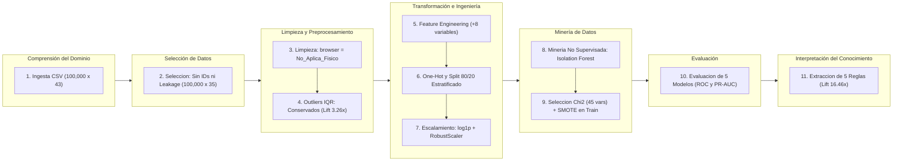
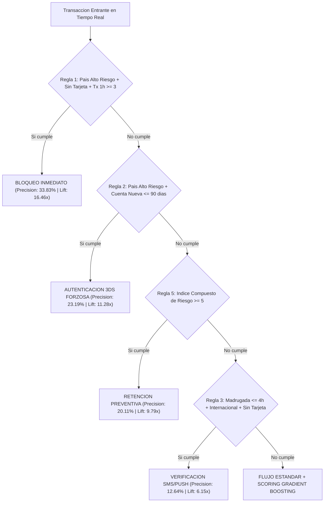

#  💳 Detección Automatizada de Fraude, Descubrimiento de Anomalías y Reglas de Decisión (KDD 2026)

[](LICENSE)
[](https://www.python.org/)
[](https://jupyter.org/)
[](https://scikit-learn.org/)
[](https://imbalanced-learn.org/)
[](https://pandas.pydata.org/)
[](https://numpy.org/)
[-8A2BE2?style=for-the-badge)]()
[](Datasets/credit_card_fraud_detection_2026.csv)
[]()

> **Proyecto Final Integrador — Minería de Datos y Descubrimiento de Conocimiento (KDD)**  
> **Institución:** Centro Universitario de Guadalajara (CUGDL) — Universidad de Guadalajara  
> **Programa:** Licenciatura en Inteligencia Artificial y Ciencia de Datos  
> **Autor:** Roberto Alejandro Chagra Martínez

---

## 1. Descripción General del Proyecto

Este repositorio implementa de principio a fin el proceso de **Knowledge Discovery in Databases (KDD)** sobre el conjunto de datos transaccionales `credit_card_fraud_detection_2026.csv` (**100,000 transacciones** y **43 atributos**) con el objetivo de:

1. **Superar el desbalance severo de clases** ($97.945\%$ transacciones legítimas vs. $2.055\%$ fraudulentas, razón $1:47.66$) donde la exactitud global (*Accuracy*) enmascara por completo a la clase minoritaria.
2. **Prevenir la Fuga de Información (*Data Leakage*) y el Sesgo de Selección (*Selection Bias*)** mediante auditoría de causalidad temporal, tratamiento semántico de valores faltantes estructurales y partición estratificada previa a cualquier escalamiento o balanceo sintético (*SMOTE*).
3. **Combinar Minería No Supervisada y Supervisada (Enfoque Híbrido):** Detectar comportamientos atípicos multivariados mediante *Isolation Forest* e inyectar sus puntajes de anomalía dentro de modelos de clasificación supervisada (*Regresión Logística*, *Árboles de Decisión*, *Random Forest* y *Gradient Boosting*).
4. **Extraer Conocimiento Accionable (*White-Box Rules*):** Traducir los patrones descubiertos en **5 Reglas de Decisión Si-Entonces (*IF-THEN*)** de alta precisión y explicabilidad para motores bancarios antifraude en tiempo real.

---

## 2. Arquitectura del Proceso KDD Implementado


---

## 3. Estructura del Proyecto

El proyecto está organizado en **tres modalidades de entrega equivalentes** (Notebook Unificado, Notebooks Modulares por Etapa y Paquete de Ingeniería de Software en Python), además de sus carpetas de datos, resultados gráficos/tabulares y documentación técnica:

```text
Deteccion_Automatizada_de_Fraude_Descubrimiento_de_Anomalías_y_Reglas_de_Decisión/
│
├── README.md                                                     # Documentación principal del repositorio
├── LICENSE                                                       # Licencia del repositorio
├── .gitignore                                                    # Reglas de exclusión para control de versiones Git
├── .gitattributes                                                # Configuración de atributos y finales de línea Git
├── requirements.txt                                              # Dependencias de Python y versiones requeridas
│
├── Datasets/                                                     # Fuente de datos transaccionales en bruto
│   └── credit_card_fraud_detection_2026.csv                      # Dataset (100,000 filas x 43 columnas)
│
├── src/Entrega_Unificada/                                            # Modalidad 1: Todo el pipeline KDD en un solo archivo
│   ├── Proyecto_Final_KDD_Deteccion_Fraude_2026.ipynb            # Notebook maestro ejecutado de principio a fin
│   └── Proyecto_final_data_mining.py                             # Script unificado ejecutable de extremo a extremo
│
├── src/Entrega_Modular_en_Notebooks_Separados/                       # Modalidad 2: Pipeline dividido en 4 cuadernos secuenciales
│   ├── 01_KDD_Seleccion_Limpieza_y_Outliers.ipynb                # Fase 1 y 2: Auditoría, imputación y análisis IQR
│   ├── 02_KDD_Transformacion_Ingenieria_y_Seleccion_Variables.ipynb # Fase 3: 8 features derivadas, Split 80/20, RobustScaler
│   ├── 03_KDD_Mineria_IsolationForest_SMOTE_y_Modelado.ipynb     # Fase 4: Isolation Forest, Chi2, SMOTE y 5 modelos
│   └── 04_KDD_Evaluacion_Interpretacion_y_Reglas_Decision.ipynb  # Fase 5: ROC/PR-AUC, matrices de confusión y reglas IF-THEN
│
├── src/Entrega_Modular_de_Ingeniería_de_Software_en_Python/          # Modalidad 3: Arquitectura modular de producción (.py)
│   ├── __init__.py                                               # Inicializador del paquete Python
│   ├── orquestador_modular_kdd.py                                # Punto de entrada que ejecuta las 4 fases en secuencia
│   ├── fase1_seleccion_y_limpieza.py                             # Módulo de carga, anti-leakage e imputación semántica
│   ├── fase2_transformacion_y_seleccion.py                       # Módulo de ingeniería de características y escalamiento
│   ├── fase3_mineria_anomalias_y_clasificacion.py                # Módulo híbrido: Isolation Forest + SMOTE + Clasificadores
│   └── fase4_evaluacion_y_reglas_decision.py                     # Módulo de evaluación financiera y extracción de reglas
│
├── results/                                                   # Artefactos visuales y tabulares generados por el pipeline
│   ├── 01_desbalance_y_tipologias.png                            # Gráfico de desbalance 97.9% vs 2.1% y tipos de fraude
│   ├── 02_outliers_iqr_y_isolation_forest.png                    # Lift de anomalías en colas IQR e Isolation Forest
│   ├── 03_seleccion_variables_importancia.png                    # Top 15 variables más importantes (Random Forest / Chi2)
│   ├── 04_comparativa_modelos_curvas_roc_pr.png                  # Curvas ROC-AUC y Precision-Recall (PR-AUC)
│   ├── 05_matrices_confusion.png                                 # Matrices de confusión comparadas en conjunto de prueba
│   ├── 06_arbol_reglas_decision.png                              # Visualización del árbol explicable de reglas de negocio
│   ├── diagnostico_outliers_iqr.csv                              # Tabla de diagnóstico estadístico de valores extremos
│   ├── resumen_modelos_kdd.csv                                   # Tabla comparativa de métricas de los 5 modelos
│   ├── reglas_negocio_validadas.csv                              # Rendimiento empírico (Soporte, Precisión, Lift) de las 5 reglas
│   └── reglas_decision_fraude.txt                                # Árbol de decisión exportado en reglas de texto plano
│
└── Documentacion_adicional/                                      # Reportes técnicos, diccionario de código y justificación
    ├── Documentacion_Tecnica_Proyecto_Final_KDD.md               # Memoria técnica detallada de las 7 etapas del proyecto
    ├── Diccionario_Funciones_Proyecto_Final_KDD.md               # Tablas de funciones utilizadas, sintaxis y resultados
    ├── Selección de base de datos.pdf                            # Documento académico de justificación del dataset
    └── Selección de base de datos.docx                           # Versión editable de la selección de base de datos
```

---

## 4. Hallazgos Principales por Etapa KDD

### 4.1 Selección de Datos y Prevención de *Data Leakage*
- **Diagnóstico de Desbalance:** De las `100,000` transacciones, `97,945` (`97.945%`) son legítimas y únicamente `2,055` (`2.055%`) corresponden a fraude confirmado, acumulando una pérdida financiera de **`$279,842.20 USD`**.
- **Tipologías de Fraude:** *Card-Not-Present* (`1,054` casos, `51.3%`), *Account-Takeover* (`447` casos, `21.8%`), *Synthetic-Identity* (`309` casos, `15.0%`) y *Card-Present* (`245` casos, `11.9%`).
- **Exclusión de Variables Prohibidas:**
  - **6 Identificadores sin valor generalizable:** `transaction_id`, `customer_id`, `merchant_id`, `device_id`, `ip_address` y `timestamp`.
  - **2 Variables con *Data Leakage* Post-Evento:** `fraud_type` y `fraud_amount_lost` (registradas únicamente después de confirmar el siniestro; incluirlas inflaría artificialmente el *F1-Score* a `1.0000` pero haría inútil el modelo en producción).

### 4.2 Limpieza, Imputación Semántica y Diagnóstico de Outliers ($1.5 \times \text{IQR}$)
- **Resolución de *Missing Values* sin Sesgo de Selección:** Se detectaron `41,709` valores nulos (`41.71%`) concentrados exclusivamente en la columna `browser`. Al cruzar con `channel`, se demostró que el **100%** pertenecen a canales físicos (`35,777` en `In-store` y `5,932` en `ATM`). Eliminar estas filas habría destruido todo el canal presencial; por ello se aplicó **imputación semántica** asignando la categoría `'No_Aplica_Fisico'`.
- **Conservación de Valores Extremos (*Outliers*):** El análisis intercuartílico ($1.5 \times \text{IQR}$) demostró que las colas extremas concentran la señal de fraude: por ejemplo, en `transactions_last_1h > 2.5` la tasa de fraude sube a **`5.57%`** (**`3.26x` más fraude** que en el rango normal). Por tanto, **no se recortaron ni eliminaron outliers**.

### 4.3 Transformación e Ingeniería de Características (*Feature Engineering*)
Se diseñaron **8 variables derivadas** fundamentadas en conocimiento del dominio bancario:
1. `velocity_tx_ratio_1h_24h`: Aceleración aguda de transacciones en la última hora frente a las últimas 24 horas.
2. `velocity_amt_ratio_1h_24h`: Concentración del gasto reciente respecto al acumulado diario.
3. `credit_utilization_ratio`: Proporción del límite de crédito consumido en la transacción actual.
4. `zscore_amount_30d`: Desviación estandarizada del monto actual frente al historial de 30 días del cliente.
5. `security_factors_count`: Índice de blindaje de autenticación (`pin_verified + 3ds_verified + card_present`).
6. `is_night_tx`: Indicador binario de transacción en horario de madrugada (`00:00` a `05:00` hrs).
7. `is_new_account`: Indicador de cuenta de reciente creación ($\le 90$ días).
8. `composite_risk_index`: Índice heurístico acumulado de banderas de alerta temprana.

> [!IMPORTANT]
> **Protocolo Estricto Anti-Leakage en Preprocesamiento:** La partición estratificada **80/20** (`80,000` entrenamiento / `20,000` prueba) se ejecutó **antes** de ajustar el escalador `RobustScaler` y antes del sobremuestreo sintético `SMOTE(sampling_strategy=0.30)`.

---

## 5. Resultados de Minería de Datos y Evaluación de Modelos

### 5.1 Descubrimiento No Supervisado de Anomalías (*Isolation Forest*)
El modelo `IsolationForest(contamination=0.05)` entrenado sin etiquetas identificó un subconjunto de transacciones anómalas cuya tasa real de fraude alcanzó **`7.07%`** en prueba (frente a `1.88%` en las transacciones normales), logrando un **Lift de `3.75x`** y aportando las variables `iforest_anomaly_score` e `iforest_is_outlier` al clasificador supervisado.

### 5.2 Comparativa de Clasificadores Supervisados (Conjunto de Prueba: $N = 20,000$, Fraudes Reales = $411$)

| Modelo Evaluado | Umbral Óptimo | Accuracy | Precision (Fraude) | Recall (Sensibilidad) | F1-Score | ROC-AUC | PR-AUC | Fraudes Detectados (TP) |
| :--- | :---: | :---: | :---: | :---: | :---: | :---: | :---: | :---: |
| **1. Baseline Mayoritario (Dummy)** | `0.50` | `0.9795` | `0.0000` | `0.0000` | `0.0000` | `0.5000` | `0.0205` | `0 / 411 (0.0%)` |
| **2. Regresión Logística (SMOTE)** | `0.35` | `0.8987` | `0.0903` | `0.4331` | `0.1495` | `0.8152` | `0.0964` | `178 / 411 (43.3%)` |
| **3. Árbol de Decisión (SMOTE)** | `0.30` | `0.9367` | `0.1349` | `0.3844` | `0.1997` | `0.8103` | `0.1109` | `158 / 411 (38.4%)` |
| **4. Random Forest (SMOTE)** | `0.50` | `0.8786` | `0.0895` | **`0.5353`** | `0.1534` | `0.8292` | `0.1039` | **`220 / 411 (53.5%)`** |
| **5. Gradient Boosting (SMOTE)** | `0.15` | `0.9313` | `0.1288` | `0.4063` | `0.1956` | **`0.8379`** | **`0.1369`** | `167 / 411 (40.6%)` |

- **Paradoja de la Exactitud Demostrada:** El clasificador *Dummy* obtiene **`97.95%` de Accuracy** pero detecta **`0` fraudes** (`PR-AUC = 0.0205`).
- **Mejor Discriminación Global:** **Gradient Boosting** alcanza el mayor **`ROC-AUC` (`0.8379`)** y **`PR-AUC` (`0.1369`)**, multiplicando por **6.6x** la precisión-exhaustividad del baseline azaroso.
- **Mayor Captura de Fraudes (*Recall*):** **Random Forest** logra interceptar **`220` de los `411` fraudes (`53.53%`)** en el conjunto de prueba.

---

## 6. Conocimiento Descubierto: 5 Reglas de Decisión Accionables (*White-Box*)

A partir del árbol de decisión interpretable y la importancia de características, se extrajeron y validaron **5 reglas de negocio listas para producción** (donde la tasa base de fraude del banco es `2.055%`):



| ID Regla | Condición Lógica (`IF`) | Transacciones Activadas | Fraudes Capturados | Precisión (Tasa de Fraude) | Lift sobre Base (`2.055%`) | Acción Bancaria Recomendada |
| :---: | :--- | :---: | :---: | :---: | :---: | :--- |
| **Regla 1** | `high_risk_country == 1` **AND** `card_present == 0` **AND** `transactions_last_1h >= 3` | `269` | `91` | **`33.83%`** | **`16.46x`** | Bloqueo preventivo inmediato |
| **Regla 2** | `high_risk_country == 1` **AND** `account_age_days <= 90` | `565` | `131` | **`23.19%`** | **`11.28x`** | Retención temporal + Verificación 3DS/Biométrica |
| **Regla 3** | `transaction_hour <= 4` **AND** `international_transaction == 1` **AND** `card_present == 0` | `902` | `114` | **`12.64%`** | **`6.15x`** | Solicitud de token dinámico (2FA / Push) |
| **Regla 4** | `amount_vs_avg_ratio > 4.8` **AND** `num_chargebacks_ever >= 2` **AND** `card_present == 0` | `611` | `62` | **`10.15%`** | **`4.94x`** | Auditoría de contracargos y llamada de confirmación |
| **Regla 5** | `composite_risk_index >= 5` *(acumulación de $\ge 5$ señales de alerta)* | `2,859` | `575` | **`20.11%`** | **`9.79x`** | Escalamiento prioritario a cola de analistas antifraude |

---

## 7. Instrucciones de Instalación y Ejecución

### 7.1 Instalación de Dependencias
Desde la raíz del proyecto, instala los paquetes requeridos (Python 3.10+):

```bash
pip install -r requirements.txt
```

### 7.2 Cómo Ejecutar cualquiera de las 3 Modalidades

1. **Modalidad 1 — Entrega Unificada:**
   - Para abrir el Notebook maestro completo:
     ```bash
     jupyter notebook "src/Entrega_Unificada/Proyecto_Final_KDD_Deteccion_Fraude_2026.ipynb"
     ```
   - O para ejecutar el script completo desde consola:
     ```bash
     python "src/Entrega_Unificada/Proyecto_final_data_mining.py"
     ```

2. **Modalidad 2 — Entrega Modular en Notebooks Separados:**
   - Abre y ejecuta en orden secuencial (`01` $\rightarrow$ `02` $\rightarrow$ `03` $\rightarrow$ `04`) los cuadernos dentro de la carpeta `src/Entrega_Modular_en_Notebooks_Separados/`.

3. **Modalidad 3 — Entrega Modular de Ingeniería de Software en Python:**
   - Ejecuta el orquestador principal que coordina automáticamente los 4 módulos (`.py`) y actualiza todos los gráficos y tablas en `results/`:
     ```bash
     python "src/Entrega_Modular_de_Ingeniería_de_Software_en_Python/orquestador_modular_kdd.py"
     ```

---

## 8. Documentación Complementaria

Para profundizar en los aspectos teóricos, matemáticos y de implementación del proyecto, consulta la carpeta `Documentacion_adicional/`:
- 📄 **[`Documentacion_Tecnica_Proyecto_Final_KDD.md`](Documentacion_adicional/Documentacion_Tecnica_Proyecto_Final_KDD.md)**: Justificación metodológica exhaustiva de las 7 etapas del proceso KDD.
- 📘 **[`Diccionario_Funciones_Proyecto_Final_KDD.md`](Documentacion_adicional/Diccionario_Funciones_Proyecto_Final_KDD.md)**: Catálogo tabular de las **38 funciones y clases** utilizadas en el proyecto, incluyendo su descripción técnica, sintaxis exacta en el código, resultado cuantitativo generado y por qué fue indispensable su uso.

---

## 9. Licencia

Este proyecto se distribuye bajo la **Licencia MIT**. Consulta el archivo [`LICENSE`](LICENSE) para más detalles.

